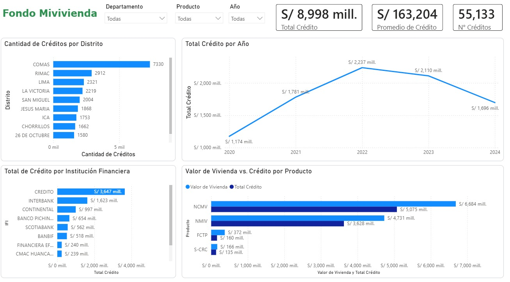

# 🏘️ Análisis de Créditos Hipotecarios del Fondo Mivivienda en el Perú (2020–2024)

## 📌 Descripción

Este proyecto implementa un **pipeline de datos** para depurar y analizar los registros históricos de colocación de créditos hipotecarios otorgados por el **Fondo Mivivienda**, obtenidos de la **Plataforma Nacional de Datos Abiertos del Gobierno del Perú**.

El objetivo es evaluar la evolución temporal, la concentración geográfica y la participación de las Instituciones Financieras (IFI) en la concesión de viviendas de interés social entre 2020 y 2024, identificando los distritos y productos con mayor volumen de financiamiento.

## 🛠️ Tecnologías y Herramientas

- **Python (Pandas):** Automatización del proceso ETL, detección de nulos, eliminación de duplicados y depuración del dataset.
- **Power BI Desktop:** Modelado de datos dimensional, creación de medidas clave en DAX y diseño del dashboard interactivo.
- **Git / GitHub:** Control de versiones y documentación.
- **Fuente de Datos:** Fondo Mivivienda / Plataforma Nacional de Datos Abiertos del Perú.

## 📸 Dashboard



## ⚙️ Proceso ETL y Tratamiento de Datos

El procesamiento de datos se encuentra automatizado mediante un script en Python que ejecuta las siguientes operaciones secuenciales:

- **Carga y Análisis Inicial:** Lectura del archivo origen (`mivivienda.csv`) para la inspección de columnas y registros.
- **Limpieza de Filas Nulas:** Detección y eliminación de registros que presentan valores completamente nulos en sus filas.
- **Control de Duplicados:** Verificación y eliminación de filas duplicadas para asegurar la consistencia del dataset.
- **Depuración de Columnas:** Eliminación de la columna `FECHA_CORTE` innecesaria para el análisis final.
- **Exportación:** Generación del archivo final optimizado y limpio (`limpio_mivivienda.csv`) listo para su consumo en Power BI.

## 📊 Principales Hallazgos

- **Métricas Consolidadas (2020–2024):**
  - **Monto total desembolsado:** **S/ 8,998 millones**.
  - **Número total de créditos:** **55,133**.
  - **Promedio de crédito otorgado:** **S/ 163,204**.
- **Pico Histórico de Colocaciones:** El año **2022** registró la mayor colocación de créditos del periodo con **S/ 2,237 millones**, en comparación con los **S/ 1,174 millones** registrados en 2020.
- **Top Distritos por Demanda:**
  1. **Comas:** 7,330 créditos
  2. **Rímac:** 2,912 créditos
  3. **Lima Cercado:** 2,321 créditos
  4. **La Victoria:** 2,219 créditos
- **Liderazgo de Instituciones Financieras (IFI):** El **Banco de Crédito del Perú (BCP)** encabeza la colocación con **S/ 3,647 millones**, seguido por **Interbank** con **S/ 1,623 millones**.
- **Dominio por Producto:** El producto **NCMV (Nuevo Crédito Mivivienda)** representa el volumen principal con **S/ 5,075 millones** financiado sobre un valor de vivienda total de **S/ 6,684 millones**.

## 💡 Recomendaciones

- Utilizar la información del análisis para priorizar la oferta inmobiliaria de interés social en zonas con alta demanda comprobada, como Lima Norte (Comas).
- Fortalecer las alianzas estratégicas entre el Fondo Mivivienda y las Cajas Municipales (CMAC) para aumentar la inclusión financiera y bancarización en provincias.
- Monitorear la tendencia post-2022 para evaluar políticas de subsidio o tasas preferenciales que impulsen el volumen de colocación anual.

> **Nota:** Este proyecto analiza la dinámica histórica del mercado crediticio social en el Perú para servir como insumo en la toma de decisiones financieras, comerciales y de políticas públicas de vivienda.

## 📁 Estructura del Repositorio

```text
Fondo-Mivivienda-Analytics/
├── .gitignore
├── README.md
├── assets/
│   └── dashboard_mivivienda.png
├── dashboard/
│   └── mivivienda_analytics.pbix
├── data/
│   ├── processed/
│   │   └── limpio_mivivienda.csv
│   └── raw/
│       └── mivivienda.csv
└── scripts/
    └── etl_mivivienda.py
